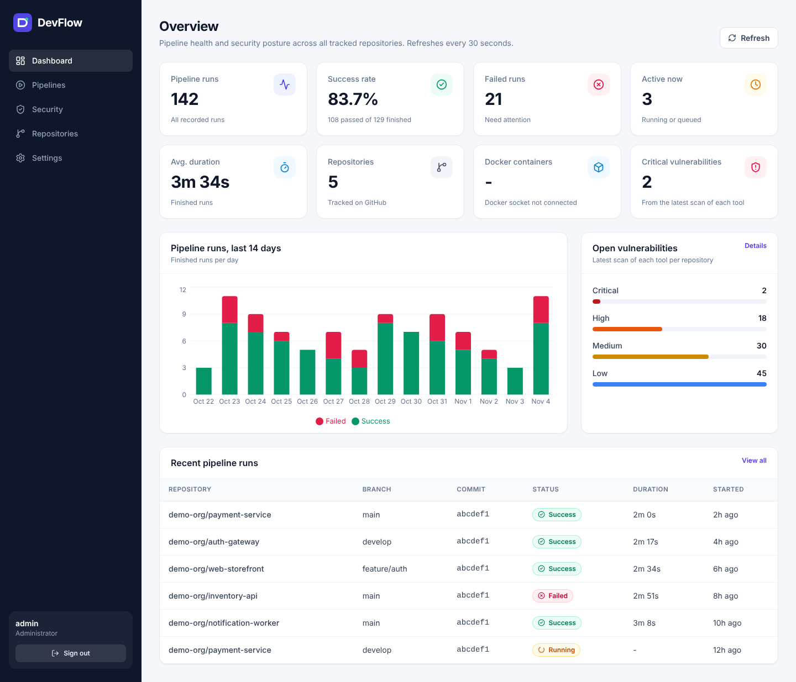
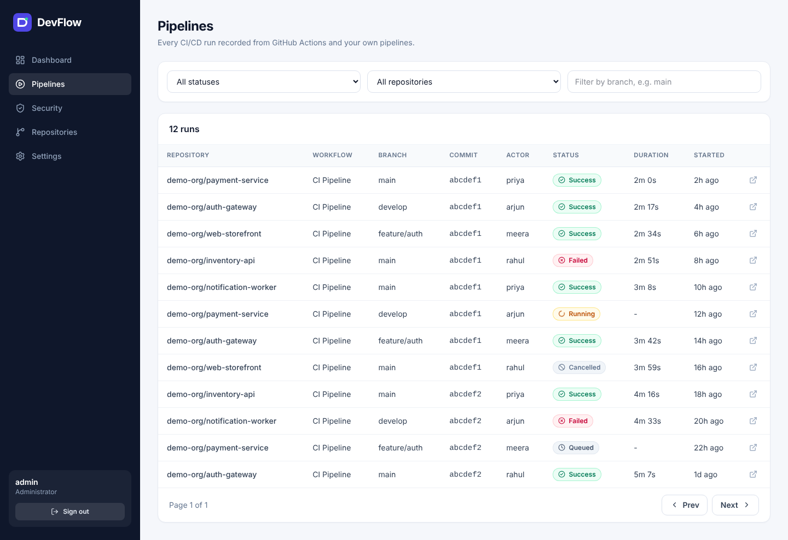
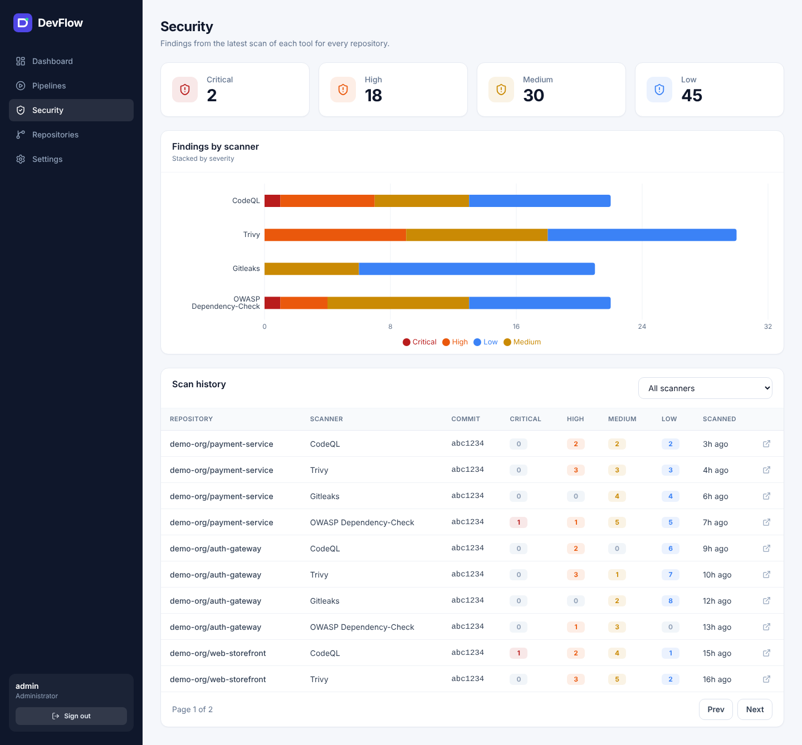
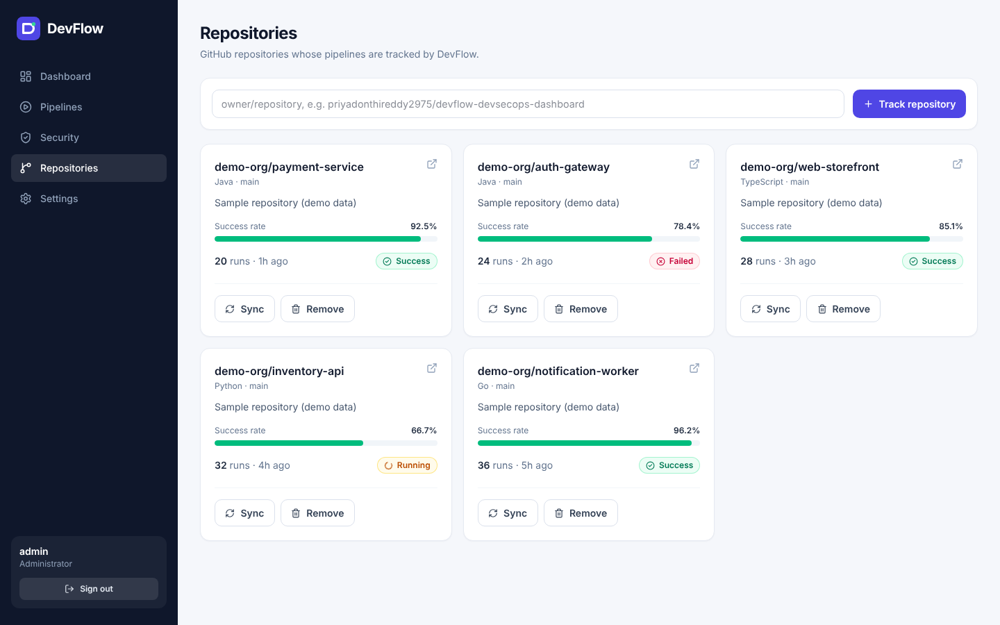
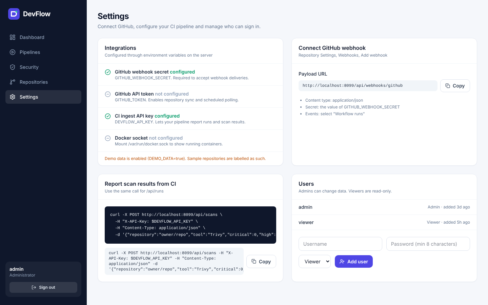
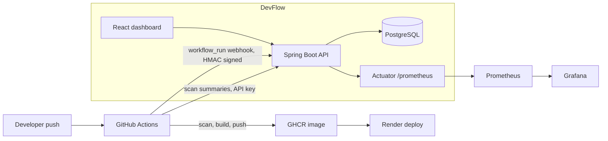

# DevFlow - DevSecOps Pipeline and Security Dashboard

DevFlow gives a team one screen for the health of their CI/CD pipelines and the security posture of their code. It records every GitHub Actions run, collects results from security scanners (CodeQL, Trivy, Gitleaks, OWASP Dependency-Check) and shows success rates, failures, durations and open vulnerabilities per repository.



## The problem it solves

Teams run many pipelines across many repositories. Without a single view, a failing build or a critical vulnerability is noticed late, usually after a deploy. DevFlow pulls pipeline results and scan results into one database and one dashboard, so problems are visible the moment they happen.

## Features

- **Live pipeline tracking.** GitHub sends a signed `workflow_run` webhook for every run. DevFlow also syncs runs from the GitHub REST API on a schedule.
- **Security results.** The CI pipeline posts a summary from each scanner after every run. The dashboard shows the latest findings per tool and repository, grouped by severity.
- **Real statistics.** Every number on the dashboard comes from the database: success rate, average duration, failures, active runs, repositories, running Docker containers and open vulnerabilities.
- **Authentication and roles.** JWT login with BCrypt-hashed passwords. Admins change data, viewers are read-only. Login attempts are rate limited.
- **Monitoring.** Spring Boot Actuator exposes Prometheus metrics, including custom `devflow_pipeline_runs` and `devflow_vulnerabilities` gauges. A Grafana dashboard is provisioned automatically.
- **Gated CI/CD.** GitHub Actions builds, tests, scans, builds a Docker image, publishes it to GHCR and triggers a Render deploy only when the checks pass.

## Screenshots

| Pipelines | Security |
|---|---|
|  |  |

| Repositories | Settings |
|---|---|
|  |  |

## Architecture



## Tech stack

| Area | Technology |
|---|---|
| Backend | Java 17, Spring Boot 3.5, Spring Web, Spring Data JPA, Spring Security, Bean Validation |
| Database | PostgreSQL 16, Flyway migrations |
| Auth | JWT (jjwt), BCrypt, role based access (ADMIN, VIEWER), API key for CI ingest |
| Frontend | React 19, Vite, TypeScript, Tailwind CSS, Recharts |
| Observability | Spring Boot Actuator, Micrometer, Prometheus, Grafana |
| Testing | JUnit 5, Spring MockMvc, H2, JaCoCo |
| DevSecOps | GitHub Actions, CodeQL, Trivy, Gitleaks, OWASP Dependency-Check, Dependabot |
| Delivery | Docker (multi-stage, non-root), Docker Compose, GHCR, Render |

## Run it locally with Docker Compose

```bash
cp .env.example .env
```

Edit `.env` and set real values for the passwords and secrets. Then:

```bash
docker compose up --build
```

| Service | URL |
|---|---|
| DevFlow | http://localhost:8080 |
| Swagger UI | http://localhost:8080/swagger-ui.html |
| Prometheus | http://localhost:9090 |
| Grafana | http://localhost:3000 (user `admin`, password from `GRAFANA_PASSWORD`) |

Sign in with `ADMIN_USERNAME` and `ADMIN_PASSWORD`. If `ADMIN_PASSWORD` is empty, a random password is generated and printed once in the app log. Set `DEMO_DATA=true` to load sample repositories so the dashboard is not empty on first run. Demo repositories are labelled as demo data.

To show the Docker container count, the compose file mounts the Docker socket read-only. Set `DOCKER_GID` in `.env` to the group id of the docker group on your host (`getent group docker`). The container count is optional and shows `-` if the socket is not available.

## Run it for development

Backend (needs Java 17 and a PostgreSQL database):

```bash
export DB_PASSWORD=devflow DB_USER=devflow DB_NAME=devflow ADMIN_PASSWORD=admin12345 DEMO_DATA=true
mvn spring-boot:run
```

Frontend (proxies `/api` to port 8080):

```bash
cd frontend
npm install
npm run dev
```

Run the tests with `mvn verify`. Tests use an in-memory H2 database by default. Set `SPRING_DATASOURCE_URL`, `SPRING_DATASOURCE_USERNAME` and `SPRING_DATASOURCE_PASSWORD` to run them against PostgreSQL, as the CI pipeline does.

## Configuration

| Variable | Purpose |
|---|---|
| `DB_HOST`, `DB_PORT`, `DB_NAME`, `DB_USER`, `DB_PASSWORD` | PostgreSQL connection |
| `ADMIN_USERNAME`, `ADMIN_PASSWORD` | First admin account, created on first start |
| `JWT_SECRET` | Signing secret for login tokens. Use a long random value |
| `DEVFLOW_API_KEY` | Key your CI pipeline uses to post runs and scans. Also used by Prometheus |
| `GITHUB_WEBHOOK_SECRET` | Shared secret for verifying GitHub webhooks. Webhooks are rejected if unset |
| `GITHUB_TOKEN` | Optional. Enables repository metadata and scheduled run sync |
| `DEMO_DATA` | `true` loads sample data when the database is empty |

Secrets are never stored in the repository. `.env` is git-ignored.

## Connect GitHub

1. In the DevFlow **Settings** page, copy the webhook payload URL.
2. In your GitHub repository go to Settings, Webhooks, Add webhook. Use that URL, content type `application/json`, your `GITHUB_WEBHOOK_SECRET`, and select the **Workflow runs** event.
3. Run any workflow. The run appears on the Pipelines page, and the repository is added automatically.

## CI/CD pipeline

`.github/workflows/ci.yml` runs on every push and pull request to `main`:

| Job | What it does |
|---|---|
| Build and test | Maven build and tests against a PostgreSQL service container, JaCoCo coverage report |
| Frontend | Type-check and production build of the React app |
| Gitleaks | Scans the full git history for committed secrets |
| CodeQL | Static analysis for Java and TypeScript |
| Trivy (dependencies) | Scans Maven and npm dependencies. Fails the build on critical findings |
| Dependency-Check | OWASP scan. Runs when the `NVD_API_KEY` secret is set |
| Docker | Builds the image, scans it with Trivy, publishes it to GHCR on pushes |
| Deploy | Calls the Render deploy hook after the checks pass |
| Report | Posts the run result and every scanner summary back to DevFlow |

Repository secrets used by the pipeline:

| Secret | Purpose |
|---|---|
| `DEVFLOW_URL` | Public URL of your DevFlow instance, for example `https://devflow.onrender.com` |
| `DEVFLOW_API_KEY` | Same value as the server's `DEVFLOW_API_KEY` |
| `RENDER_DEPLOY_HOOK_URL` | Render service deploy hook. Optional |
| `NVD_API_KEY` | Free NVD API key for OWASP Dependency-Check. Optional |

## Deploy to Render

1. Push this repository to GitHub.
2. In Render choose New, Blueprint, and select the repository. `render.yaml` creates the web service and a PostgreSQL database and generates the secrets.
3. Open the service Environment tab to read the generated `ADMIN_PASSWORD`, `DEVFLOW_API_KEY` and `GITHUB_WEBHOOK_SECRET`. Optionally set `GITHUB_TOKEN`.
4. To deploy only when the pipeline passes, turn Auto-Deploy off in the service settings, copy the Deploy Hook URL and save it as the `RENDER_DEPLOY_HOOK_URL` repository secret.
5. Save `DEVFLOW_URL` and `DEVFLOW_API_KEY` as repository secrets so the pipeline reports back.

Render free instances sleep when idle, and the free PostgreSQL database expires after 30 days. Use a paid plan for anything beyond a demo.

## API overview

| Method and path | Access | Purpose |
|---|---|---|
| `POST /api/auth/login` | public | Returns a JWT |
| `GET /api/dashboard`, `/api/dashboard/trend` | any user | Summary statistics and 14 day trend |
| `GET /api/runs` | any user | Paged runs, filter by `status`, `repository`, `branch` |
| `POST /api/runs` | admin or API key | Record or update a run |
| `GET /api/scans`, `/api/scans/summary` | any user | Scan history and severity totals |
| `POST /api/scans` | admin or API key | Record a scanner summary |
| `GET /api/repositories` | any user | Tracked repositories with statistics |
| `POST /api/repositories`, `POST /api/repositories/{id}/sync`, `DELETE /api/repositories/{id}` | admin | Manage repositories |
| `POST /api/webhooks/github` | HMAC signature | GitHub workflow_run events |
| `GET /api/users`, `POST /api/users` | admin | Manage users |
| `GET /actuator/health` | public | Health check |
| `GET /actuator/prometheus` | admin or API key | Metrics |

Full interactive documentation is at `/swagger-ui.html`.

## Security notes

- Passwords are hashed with BCrypt. Login is rate limited per username.
- Webhooks are verified with HMAC-SHA256 and rejected when no secret is configured.
- The API is stateless and every `/api` route requires authentication except login and the webhook.
- The container runs as a non-root user.
- The frontend stores the login token in `localStorage`. This is simple but means an XSS bug would expose the token. The UI renders all data through React, which escapes output, and never injects raw HTML.
- Replace the default passwords and set `JWT_SECRET` before exposing an instance to the internet.

## Known limitations and ideas

- Scan results are summaries (counts per severity). Individual findings are not stored.
- Run history synced from GitHub is limited to the latest 30 runs per sync.
- Possible next steps: Slack or email alerts on failures, per-finding detail pages, Kubernetes manifests, Terraform.

## License

MIT
